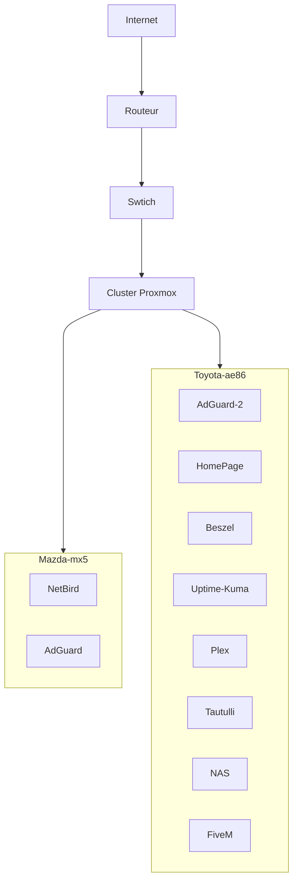

# GitHub - Kelyan

## Qui es-tu ?
Hey , moi c'est Kelyan CARRADINHA j'ai 21 ans et je suis en BTS SIO option SISR dans l'établissement Ensitech à Cergy en alternance au sein du Conseil départemental du Val-d'Oise pour une durée de 2 ans !

## Que fais-tu / qu'apprends-tu ?
Dans le BTS pour l'instant nous avons eu des TP ( travaux pratiques ) sur la Virtualisation de machines avec Oracle VirtualBox où nous avons dû monter plusieurs machines selon le TP comme windows server , Ubuntu , Debian , Win11 et pfSense et ensuite tout faire selon ce qui était demandé par exemple nous avons eu : 
- IP_DHCP_FIREWALL
- PUBLICATION_NAT
- SUPERVISION_ZABBIX
- GESTION_DE_PARC_GLPI
et bien d'autres en tout pour la première année nous avons 17 TP a réaliser ! 

Au sein du Conseil départementale du Val-d'Oise ( pour l'alternance ) notre mission est de gérer les collèges de tout le Val-d'Oise , on fait de la masterisation de poste , aussi les tablettes pour les différents collèges avec jamfcloud , On répond ou traite les tickets , on se déplace dans les collèges pour effectuer des dépannage , remplacement de poste et bien plus.

## Quels sont tes projets ? 
J'ai plusieurs projets qui me tiennent à cœur , notamment celui de mon entreprise individuelle que j'ai ouvert il y a peu. Je fais du dépannage, Montage et maintenance d'ordinateur que se soit un PC fixe ou bien portable dans toute l'Île-de-France et l'Oise. J'ai pu coder mon [site](https://kck-it.fr) à l'aide de l'IA Claude qui a pu m'assister dans le codage de ce dernier, une aide bien plus que précieuse !
J'ai aussi un DashBoard pour mon entreprise pour gérer/traiter toutes les demandes des clients qui est entièrement privé il n'y a que moi qui ai les accès et toutes les demandes des clients arrivent directement là-bas au lieu de passer par un professionnel cela évite la fuite de données et perte de données.
Chez moi j'ai aussi pu monter un **homelab** et j'en suis fier j'ai 2 PC qui tournent en cluster sur Proxmox avec différents services tels que : 
- AdGuard 
- NetBird 
- Homepage
- Plex 
et bien d'autres je le développe petit à petit en cherchant sur internet ce qui peut être utile pour mes besoins ! 
Pour mon projet de fin de deuxième année de BTS SIO SISR je vais devoir rendre un [**PORTEFOLIO**](https://portfolio-kelyan.web.app)

## Comment te contacter ?
- Juste a cliqué sur mon [site](https://kck-it.fr/#contact)
- Mon [mail-pro](mailto:kck-it.contact@kck-it.fr) pour tout contact en rapport avec mon activité ! 
- Mon [mail-perso](mailto:kelyan.carradinha8@gmail.com) pour tout types de contact ! 

